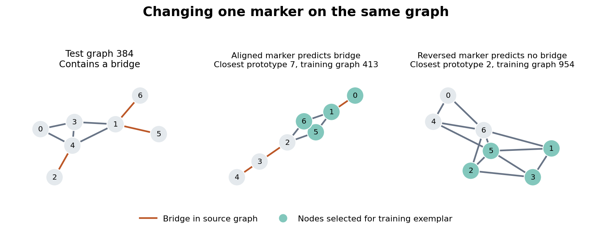

# Can ProtGNN recognise a bridge?

On 853 seven-vertex graphs, the group's plain GCN reached **98.06%** test accuracy and its ProtGNN reached **82.56%**. Both beat the majority baseline. A one-line rule, “predict a bridge if the graph has a vertex of degree one,” reached **99.61%** on the same splits. When we added an artificial marker, ProtGNN's accuracy rose to **95.35%**. Changing only that marker then reversed every prediction from its validation-selected checkpoints.

## Dataset and question

The Graph Atlas lists small, non-isomorphic, undirected graphs. We took every connected graph with exactly seven vertices and defined a binary task. A graph is positive if deleting a single edge can disconnect it. There are 351 positives and 502 negatives. Holding the size fixed rules out counting vertices as a solution. Unlike the paper's molecules and text graphs, these labels can be checked exactly. We independently verified all 853 by deleting each edge and checking connectivity. The graph catalogue is published data. The labels and experiment design are our extension. [NetworkX Graph Atlas](https://networkx.org/documentation/stable/reference/generated/networkx.generators.atlas.graph_atlas_g.html) · [Definition of a bridge](https://networkx.org/documentation/stable/reference/algorithms/generated/networkx.algorithms.bridges.bridges.html) · [Graphs, labels and atlas IDs](graphs.csv)

A leaf always has a bridge. Only **five** graphs have a bridge without a leaf (IDs 447, 450, 567, 576 and 726). The leaf rule gets 848 of 853 right across the whole catalogue. Only ID 567 appears in any of the three test sets, in seed 3. Clean ProtGNN classified it correctly and the plain GCN missed it. A single held-out example gives little evidence about learning the general bridge rule.

## Experiment

We used the group's GCN backbone and graph trainer for both variants. Each graph has both edge directions. Each node carries a constant, its degree divided by six, and a marker. The clean marker is zero. In the marked training condition, its value is +1 or −1, agrees with the graph label with probability 0.95, and is copied to every node. The marker is deliberately constructed from the label for this controlled test. The inference model sees only node features and edges.

Seeds 1, 2 and 3 each give 682 training, 85 validation and 86 test graphs. All four variants share the split for a given seed. Fits use Adam at 0.005, batches of 24, three 128-unit layers, max pooling, and the first checkpoint attaining the highest validation accuracy. The limit is 500 epochs with the group's early-stopping patience of 100. ProtGNN uses five prototypes per class, cluster/separation/diversity weights of 0.10/0.05/0.01, and the existing MCTS projection from epoch 100. The audit runs after checkpoint selection. [Training code](../../models/train_gnns.py) · [Split membership and markers](splits.csv) · [Paper, experimental settings](https://ojs.aaai.org/index.php/AAAI/article/view/20898)

### Test accuracy and runtime

Accuracy and balanced accuracy are percentages. The ± values are sample standard deviations across the three splits. Balanced accuracy gives the two classes equal weight. Timing covers the trainer, including validation, testing and checkpoint writes. Dataset generation, the later audit and drawing take place outside that interval. [Exact per-seed metrics](seed-metrics.csv)

| Training condition | Seed 1 | Seed 2 | Seed 3 | Mean accuracy ± SD | Balanced accuracy | Seconds per fit ± SD |
|---|---:|---:|---:|---:|---:|---:|
| Majority class | 63.95 | 53.49 | 66.28 | 61.24 ± 6.81 | 50.00 | — |
| Degree-one rule | 100.00 | 100.00 | 98.84 | 99.61 ± 0.67 | 99.43 | — |
| Clean GCN | 98.84 | 96.51 | 98.84 | 98.06 ± 1.34 | 98.04 | 13.78 ± 1.33 |
| Clean ProtGNN | 83.72 | 81.40 | 82.56 | 82.56 ± 1.16 | 83.94 | 16.81 ± 0.20 |
| GCN with marker | 98.84 | 94.19 | 97.67 | 96.90 ± 2.42 | 96.34 | 16.79 ± 4.35 |
| ProtGNN with marker | 95.35 | 94.19 | 96.51 | 95.35 ± 1.16 | 95.14 | 16.04 ± 0.57 |

The clean ProtGNN trailed the plain GCN on all three splits, by **15.50 percentage points** on average. These scores describe this finite graph family, architecture and training recipe. The three test sets overlap and contain 224 distinct graphs across 258 seed–graph pairs.

### Comparison with the paper and the group's results

The paper compares a plain encoder with one that classifies by weighted similarities to learned prototypes. It reports comparable accuracy on its original tasks. ProtGNN+ adds a conditional subgraph sampler. The group's archive includes GCN, GIN and GAT experiments, an HIV extension, and prototype visualisations. The table uses GCN throughout, as in our extension. The project documents incomplete support for ProtGNN+ and has no three-seed Graph-Twitter result. BA-Shape is a node-classification task. [Paper, Table 1](https://ojs.aaai.org/index.php/AAAI/article/download/20898/20657) · [Group methods](../../README.md) · [Archived results](../)

| Dataset | Paper GCN | Paper ProtGNN | Group GCN | Group ProtGNN | Group difference in points |
|---|---:|---:|---:|---:|---:|
| MUTAG | 73.3 | 76.7 | 71.67 | 68.33 | −3.33 |
| BBBP | 84.6 | 89.4 | 85.40 | 73.47 | −11.93 |
| Graph-SST2 | 89.7 | 89.9 | 89.50 | 88.10 | −1.40 |
| Graph-Twitter | 67.5 | 68.9 | — | — | — |
| BA-Shape | 91.9 | 95.7 | 92.40 | 48.57 | −43.83 |
| HIV | — | — | 96.63 | 96.63 | 0.00 |
| **Atlas-Bridges, clean** | — | — | **98.06** | **82.56** | **−15.50** |

The historical values come from the committed model summaries at `02571fb`. Differences were calculated before rounding. HIV accuracy alone gives no breakdown by class. Scores across different tasks and timings from different machines should be interpreted within each dataset.

## Does changing the marker change the answer?

We froze each marked model and showed it the same test graph three ways. One marker agrees with the label, one is set to zero and one is reversed. The adjacency matrix, degree features and label are identical. The paired flip rate counts graphs whose predicted class changes from aligned to reversed. “Closest prototype” means the minimum-distance vector. The classifier combines all ten similarities in its decision.

| Validation-selected model trained with the marker | Aligned accuracy | Masked accuracy | Reversed accuracy | Predictions flipped | Closest prototype changed |
|---|---:|---:|---:|---:|---:|
| Plain GCN | 99.22% | 84.88% | 55.04% | 44.19% | — |
| ProtGNN | 100.00% | 63.57% | 0.00% | 100.00% | 100.00% |

For example, graph 384 has three bridges. With the aligned marker, seed 1 predicts a bridge with probability 0.535 and prototype 7 is closest. Reversing the marker lowers that probability to 0.481 and prototype 2 becomes closest. The two training exemplars below were retrieved by MCTS at the frozen checkpoint. The example is the lowest-ID bridge-positive test graph whose prediction flipped in seed 1. [Per-graph probabilities and prototype IDs](ProtGNN-Cue/GCN/seed_1/predictions.csv)



For the 15 bridge-class exemplars from the clean checkpoints, the selected nodes contain both endpoints of an original bridge in **2/15** cases. A uniformly chosen connected set of the same size on each source graph would average **70.78%** coverage. The marked checkpoints retain a bridge in **4/15** cases, against **27.08%** for the matched sets. We enumerated the connected sets exactly. These small counts describe retrieved exemplars. MCTS zeroes unselected node features while retaining edges. When pruning disconnects the graph, keeping only the largest component can leave fewer than five nodes. A single exemplar cannot reconstruct the classifier's decision. [Exemplar coverage by prototype](prototype-coverage.csv)

### What happened after prototype projection?

All six prototype fits completed one round of ten projections at epoch 100. Validation selected clean epochs 9, 10 and 9, and epoch 0 for all marked fits (zero-based, after one training epoch). The main accuracy table therefore describes latent prototypes before projection. Once we saw this, we ran a secondary check on the last saved checkpoints. This check involves both projection and subsequent training, so it cannot isolate the effect of projection alone.

| Last saved ProtGNN | Epochs by seed | Observed accuracy ± SD | Balanced accuracy | Reversed accuracy | Predictions flipped |
|---|---|---:|---:|---:|---:|
| Clean | 100, 110, 100 | 61.24% ± 6.81 | 50.00% | 61.24% | 0.00% |
| With marker | 100, 100, 100 | 86.05% ± 17.13 | 85.14% | 2.71% | 87.98% |

The clean checkpoints predicted “no bridge” for every test graph. In the marked runs the closest prototype still switched on every pair, while the decision switched on 227 of 258 pairs. The clean model had only seen zero-valued markers during training, so its ±1 inputs are outside its training conditions. [Scores per seed](after-projection.csv) · [Predictions per graph](after-projection-predictions.csv)

## A feasible project on scheming

**Can a prototype-based monitor recognise labelled behaviour on a task it has never seen?** The marker experiment shows how a monitor could learn a misleading cue. Strategic scheming also requires an agent pursuing a concealed objective. The Atlas classifier has neither an agent trajectory nor a goal. The follow-up below would evaluate a monitor using recorded behaviour. [In-context scheming](https://arxiv.org/abs/2412.04984) · [Graph rationales and shortcuts](https://arxiv.org/abs/2201.12872) · [Monitoring agent transcripts](https://arxiv.org/abs/2506.15740)

1. **Use recorded traces.** The BlackboxMonitorsMATS dataset card describes a Control Arena subset with 7,500 traces and balanced honest/scheming labels. Access requires accepting the research-use conditions on Hugging Face. A course-sized pilot could use 400 traces across four task families, targeting 50 per label per family where available. Audit a small blinded sample to establish whether the labels describe visible behaviour or the generating agent's assigned condition. [Dataset card, schema and access terms](https://huggingface.co/datasets/Syghmon/blackboxmonitorsMATS)
2. **Represent what a monitor can see.** Make nodes for assistant turns, tool calls and returned results. Connect consecutive events and match each call to its result. Start with role, coarse action category and relative position. Exclude hidden instructions, reasoning, filenames, source identifiers and evaluator verdicts from the inputs. Anonymise task-specific tool names.
3. **Test on unfamiliar tasks.** Deduplicate repeated trajectories and group shared prompts or task variants. Hold out an entire task family for testing and a different family for validation. Rotate the held-out families. Compare an event-count logistic regression, the plain GCN and ProtGNN on identical folds. Report PR-AUC, balanced accuracy and recall at a validation-chosen false-positive threshold, along with the actual error counts.
4. **Check the explanations.** Have two teammates independently mark which visible events support the label in a small held-out sample, before showing them model outputs. Pick the prototype contributing most to each predicted class margin. Search the held-out trace with MCTS for the event subset closest to that vector. Compare the selected events with the annotations and with a size-matched random selection. Repeat after removing source-specific formatting. A large drop would be evidence of a dataset shortcut. This study is proposed work. All measurements above use the Atlas.

## Reproduce the experiment

From the repository root in the project Python environment, choose a fresh output folder. The first command runs all twelve fits. The next two reuse those checkpoints and take no training time.

```bash
python -m extensions.atlas_bridges.run --output atlas-rerun
python -m extensions.atlas_bridges.after_projection atlas-rerun
python -m extensions.atlas_bridges.prototypes atlas-rerun
```

Each variant has a `GCN/summary.csv`, a `summary.json` and three seed folders with logs, best and latest checkpoints, and test predictions. Prototype runs also include the retrieved nodes, training graph IDs and similarity scores. A fresh repeat reproduced all 24 checkpoint files, 12 training logs, 12 test prediction files and six prototype manifests byte for byte. The per-seed metrics also matched, apart from elapsed time.

We ran on one CPU thread on an Intel Core Ultra 9 386H using PyTorch 2.13.0+cu130 and PyG 2.8.1. The repository pins PyTorch 2.14.1. The trainer and loss are the group's implementation. The shared MCTS file loads its plotting utility inside its standalone demo, so this graph-only experiment can run without importing RDKit. [Recorded environment](environment.json) · [Extension source](../../extensions/atlas_bridges)
